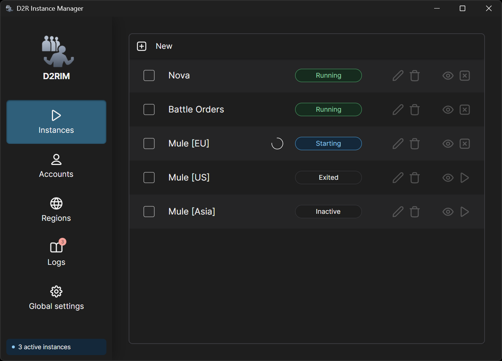

# D2R Instance Manager

## Overview
**D2R Instance Manager** is a desktop application that facilitates launching and managing multiple **Diablo II: Resurrected** instances on a single computer (a.k.a. _multiboxing_).

---

## Preview

---

## Download

Latest release: [v0.1 (2026-11-13)](https://github.com/pikrog/d2r-instance-manager/releases/tag/v0.1)

---

## Features
* Launch multiple Diablo II: Resurrected (D2R) instances with individual settings for
  * Region and Battle.net account credentials
  * Display / monitor selection (multi-monitor setups)
  * Show window hotkey
  * Command-line launch options
* Manage regions and Battle.net accounts
* Hotkey support for restoring / showing instance windows and automatic repositioning of the mouse cursor
* Automatic configuration: locating the game executable path
* Configurable secure storage of account credentials
  * Windows Account protection (no passphrase required)
  * Passphrase-based protection
* Detailed process management logging
* No third-party tools required (e.g. Process Explorer, Handle)
* No administrator privileges required

---

## ⚠️ Security Notice ⚠️

This application currently passes Battle.net credentials **via command-line arguments**. While credentials are stored *encrypted* in the configuration file, they can still appear in plain text in the process command line.

This may pose a security risk, especially on shared or multi-user systems.

---

## Disclaimer

This project is an **independent, community-created tool** and is **not affiliated with, endorsed by, or supported by Blizzard Entertainment, Inc.** Diablo II: Resurrected and Battle.net are trademarks or registered trademarks of Blizzard Entertainment.

Using third-party tools, including multiboxing software, **may violate Blizzard Entertainment’s Terms of Service or End User License Agreement**. The author of this application takes **no responsibility** for any consequences resulting from its use, including but not limited to account suspension, termination, or other penalties.

By using this software, you acknowledge that you do so **at your own risk** and are solely responsible for ensuring compliance with all applicable terms, policies, and local laws.
